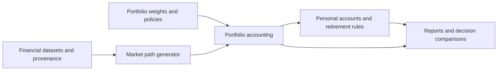

# Financial Simulations: portfolio futures and Australian retirement

Planning baseline: 28 October 2026. Status: Stage 1A implemented and validated
against synthetic cases and the local optimiser. This includes strict data and
weight adapters, daily accounting, cash flows, annual/buy-and-hold policies,
static PNG plots and a reproducible baseline report. Stage 1B now implements
joint daily replay/bootstrap and a calibration/block-length sensitivity runner.
See [Stage 1A evidence](docs/validation/stage-1a.md) and
[Stage 1B evidence](docs/validation/stage-1b.md). Stages 1C onward remain proposed.

The initial retirement scenario is for one person who remains an Australian tax resident. Couples follow after the single-person model is validated. Account ownership, dates of birth and access conditions should be represented individually from the start so that adding a partner does not require replacing the engine.

The companion [literature review](docs/literature-review.md) records the research behind the model choices, their limitations and the recommended order of implementation.

The project is `financial_simulations`, with its source repository at [mwilczynska/financial_simulations](https://github.com/mwilczynska/financial_simulations). Daily returns are a project requirement throughout loading, calibration, path generation, portfolio accounting and retirement accounting. Detailed methodology and the reasons for material decisions are maintained as versioned project documentation alongside implementation.

## Outcomes the project should support

Stage 1 answers: given assets, weights and a rebalancing policy, what range of future portfolio outcomes follows from specified market assumptions?

Stage 2 answers: given starting investments, super, earnings, contributions and spending, can the person fund their life before and after access to super, and how do alternative choices affect that result?

Useful planning questions include:

- How much accessible wealth is needed to bridge early retirement to super access?
- How much can be contributed to super without making that bridge too fragile?
- What spending can be sustained, and what spending cuts might be needed?
- How do different portfolios inside and outside super change the outcome?
- What happens if returns disappoint, inflation persists or retirement lasts longer?
- Which decisions continue to work across several plausible market models?

## What the existing projects provide

The datasets project publishes 14 daily CSV/Parquet series, mostly from 1970, with source and quality fields. The optimiser reads adjusted-close histories, supports annual rebalancing and buy and hold, and exports numeric asset weights and historical statistics. Its current default asset set is global stocks, global bonds, gold and commodities.

This is the third project, with its own Python package and scenario files. The workspace initially contained no simulation implementation.

| Existing capability or finding | Consequence for this project |
| --- | --- |
| CSV results contain explicit weight columns | Import those columns; do not execute the exported Python syntax string. |
| Optimiser aliases differ from dataset aliases | Maintain an explicit mapping, including `COMM` to `CMDTY`, `GOLDPM2x` to `GOLD2X`, and the leveraged aliases' case conventions. |
| Several principal series are measured in USD | Declare the currency of every series and the spending currency. Add an explicit AUD conversion layer. |
| Existing `CPI` is US CPI-U | Preserve its identity. Australian purchasing-power reports require Australian inflation or an explicitly stated Australian inflation assumption. |
| Total returns incorporate distributions | Reuse these directly for growth simulations. Do not add distributions a second time. |
| Income can be separated only for some asset/period combinations | Audit the semantics of price and total-return fields before estimating taxable income. |
| Some fund returns already include expenses and financing | Track embedded costs; charge only additional costs that the scenario actually incurs. |
| Early observations include reconstructions and source changes | Carry provenance into calibration and compare full-history results with alternative sample windows and suitable observed segments. |
| The optimiser's rankings use the same historical sample used for selection | Treat selected portfolios as candidates, and evaluate their stability with holdouts and other assumptions. |

### Distribution audit: the precise distinction

All 14 published CSV headers expose `Price Return` and `Total Return`, but none exports a separate cash-dividend or distribution-event column. That does not mean income is absent from performance.

- `USLCAP` has separate price and total-return series. An implied income contribution may be useful where those series represent compatible exposures. In the early segment, the price series is S&P 500 while total returns use a CRSP/French proxy, so their difference is not an observed dividend record.
- `GLSTOCK` explicitly publishes total return in both level columns and both return columns. Distributions are incorporated, but cannot be separated using those fields.
- `GLBOND` also documents both return fields as a total-return proxy.
- `GLSTBOND` documents a gross-versus-net fee distinction between the two columns. Their difference must not be labelled distribution income.
- For commodities, excess return versus total return includes collateral economics; that distinction is not itself a fund cash-distribution schedule.

The first tax-data task is therefore a capability table by asset and source segment: observed income events, defensible implied income, income embedded but inseparable, or an economic return distinction with another meaning. Reuse available information, add explicit assumptions where necessary, and seek additional sources for the remaining gaps. An index income estimate still does not provide an actual ETF's Australian tax-statement components.

## Architecture and contracts

Keep three independent responsibilities:



The market generator knows about assets, inflation, FX and economic assumptions. Portfolio accounting applies holdings, cash flows, rebalancing and costs. The retirement model applies ownership, tax, super access, contributions and spending. A withdrawal strategy can change without refitting the market generator.

### Inputs

- A portfolio specification: canonical asset identifiers, weights, currency, rebalancing policy, additional costs and any allocation changes over time.
- A market specification: historical calibration window, generator, parameters, inflation/FX treatment, horizon, number of paths and random seed.
- A retirement specification: people, accounts, opening tax positions, work and contribution schedules, spending needs and withdrawal policy.
- A dated Australian rule set: effective dates, financial-year parameters, sources and the chosen assumptions for future policy.

Scenarios should be files that can also be constructed from Python. Use a small typed Python core, NumPy for path calculations and pandas at the data/reporting boundaries. Start with a command-line runner and notebooks for exploration. Produce a self-contained HTML report and CSV/Parquet outputs, consistent with the existing projects' local workflow.

### Data requirements and conventions

1. Calibrate from asset histories rather than only a portfolio's CAGR and standard deviation. A statistics-only mode can be a useful illustration, but cannot reconstruct correlations, changing weights or account-specific asset allocation.
2. Declare simple returns versus log returns, arithmetic means versus geometric growth, nominal versus real amounts and embedded fees. Historical CAGR is not the mean of a normal simple-return model.
3. Jointly model or resample assets and relevant economic factors. Independently drawing stocks, bonds, FX and inflation destroys the relationships under examination.
4. Calculate tax and maintain tax cost bases in nominal AUD, then deflate report values into today's purchasing power.
5. For an unhedged USD series, with `S` defined as AUD per USD, `1 + return_AUD = (1 + return_USD) * S_end / S_start`. Use the inverse when source FX is quoted as USD per AUD. Test the direction with simple examples.
6. Keep daily returns throughout loading, calibration, historical replay, resampling, generated market paths and portfolio/account compounding, matching the financial datasets. Monthly and annual values are report summaries derived from the daily results. When constructing leveraged paths from underlying assets, implement the daily reset, financing and expenses with explicit trading-date and calendar-day accrual conventions. Do not apply leverage to aggregated monthly or annual returns.
7. Preserve common-period and missing-data rules. Do not silently fill missing investment returns with zero or treat interpolated inflation as new observed information.
8. Save a run manifest with configuration, code version, input hashes, coverage, quality selections, fitted parameters, random generator/seed, model version and rule-set version.
9. Distinguish the trading-observation grid from the calendar-date event ledger. Maintain daily account state; salary, contributions, spending and tax settlements occur on their configured dates. Holidays, weekends, non-trading-date events and the elapsed days used to accrue costs require documented treatment. Carrying a valuation or interpolating a lower-frequency factor does not turn it into an observed market quote or daily inflation observation.

New reusable Australian CPI, FX, cash-rate and instrument-income datasets belong in the datasets project. This project consumes them through adapters. The historical Australian CPI series has frequency and rebasing changes; any monthly reconstruction of earlier quarterly observations needs a documented convention. RBA daily FX coverage also does not span the entire 1970 asset history, so coverage decisions must be explicit. See [ABS CPI methodology transition](https://www.abs.gov.au/statistics/economy/price-indexes-and-inflation/consumer-price-index-australia/oct-2025) and [RBA historical data](https://www.rba.gov.au/statistics/historical-data.html).

## Stage 1: portfolio futures

### 1A. Establish a reproducible baseline

Build the asset registry, loader, alias mapping and portfolio specification. Read either hand-entered weights or a selected optimiser result. Recompute the relevant return history rather than assuming the exported summary statistics completely describe it.

Implement daily deterministic compounding and portfolio accounting first. Include contributions and withdrawals as generic dated cash flows without tax or super rules. Support the existing annual-rebalancing and buy-and-hold choices, with explicit opening-date and transaction-order conventions.

An initial USD nominal example can use current datasets immediately. Australian real-spending interpretation follows once Australian inflation and FX inputs or clearly labelled assumptions are supplied.

Deliverable: a small Python example and report that reproduce a specified historical portfolio case, plus hand-calculated examples of compounding and cash flows.

Implemented in package 0.1.0 with examples under `scenarios/examples/`. The
four-asset baseline uses 2010-2025, when the inspected source calendars align.
Earlier mixed calendars fail explicitly pending a reviewed alignment policy.
The first reporting pass generates wealth, drawdown and allocation PNGs directly
from Python and reviews those images visually. Interactive plots are a later
extension; PDF generation is excluded by user instruction. See the
[adapter method](docs/methodology/data-adapters.md),
[accounting method](docs/methodology/portfolio-accounting.md) and
[Stage 1A validation](docs/validation/stage-1a.md).

### 1B. Historical replay and dependence-preserving bootstrap

Implemented: joint samplers, complete-window checks, reconciled daily batch
accounting, configurable sensitivity comparison and PNG reports. The first
nominal USD experiment uses strict modern calendars, an observed account-date
template and no dated cash flows. See [resampling](docs/methodology/resampling.md)
and [executed validation](docs/validation/stage-1b.md) for this supported scope.

Implement:

- Contiguous rolling historical windows, preserving the complete sequence of joint returns and available inflation/FX factors.
- An independent joint-row bootstrap as a diagnostic benchmark.
- Moving blocks of consecutive observations, with a configurable block length.
- A stationary bootstrap with geometrically distributed block lengths and a configurable expected length.

The stationary bootstrap is the recommended initial stochastic workhorse, with the moving-block implementation as a transparent comparator. Sample joint daily return rows, and express block lengths in trading observations. Candidate mean lengths such as 21, 63, 126, 252, 504 and 1,260 observations are sensitivity settings to investigate, not validated defaults or exact calendar durations. Inspect dependence in daily returns, squared returns, inflation and important cross-series relationships. Lower-frequency factors require a documented daily alignment and resampling treatment. Automatic block-length methods may inform that investigation; they do not automatically optimize a retirement shortfall statistic.

Use the same selected dates for every jointly sampled asset and factor. Preserve observed within-block sequences. Record boundary and wraparound treatment. Resample returns or suitable changes rather than concatenating raw price levels.

Historical replay must show how many complete windows actually exist. A 50- or 60-year retirement cannot be validated by presenting incomplete windows as complete, and overlapping start dates are not independent retirement experiments. A repeated or stitched history must have a separate label.

Deliverable: one configurable portfolio compared across historical replay, independent draws and both block methods, including sensitivity to sample period and block length.

### 1C. Statistical Monte Carlo and assumption uncertainty

Add a correlated daily log-return model as an understandable parametric benchmark. Calibrate the daily log-return mean and covariance consistently, validate simulated moments, and translate any requested annual or arithmetic return assumption correctly under a stated time basis. Generate daily paths rather than generating annual returns and spreading them across days.

Support explicit forward assumptions that differ from the historical mean. Show at least base, lower-return and persistent-high-inflation cases. These are user/research assumptions with recorded rationale; historical estimates remain separately visible.

Represent uncertainty in long-run assumptions separately from random daily shocks. Start with a transparent scenario grid. A subsequent outer parameter-sampling layer can hold a sampled long-run assumption persistent through a path. Redrawing a supposedly uncertain long-run mean independently each day does not represent the same uncertainty.

Heavy-tail, mixture, regime and volatility models are later candidates. A chosen distribution must have appropriate return support and moments; do not silently clip impossible returns or introduce an uncontrolled exponentiated heavy-tail distribution.

Deliverable: a report showing the effect of generator choice and return assumptions on the same candidate portfolios.

### 1D. Evaluation and reporting

Report wealth and real purchasing-power percentiles over time, terminal-wealth distribution, probability of missing a stated target, drawdown/recovery statistics and selected complete sample paths. Pointwise percentile bands are not individual realizable life histories; show traceable paths as well.

Use shared simulated economic paths when comparing portfolios or strategies within a model. This reduces comparison noise. Across different generators, report disagreement openly rather than combining results into a single probability with arbitrary model weights.

Separate simulation sampling error from parameter uncertainty and disagreement between models. Increasing the path count reduces the former; it does not add independent historical evidence or remove calibration bias.

Validation includes:

- Closed-form deterministic and zero-return cases, including cash-flow timing.
- Reconciliation with the existing optimiser for a specified supported case and matching conventions.
- Preservation of daily return rows, day-by-day compounding, and monthly/annual report summaries reconciled to the daily paths, with no double counting of distributions or embedded fees.
- Trading-calendar alignment, non-trading-date events and elapsed-calendar-day fee/financing accrual, including weekends and holidays.
- Joint-series and block-continuity checks on synthetic dependent data.
- Statistical moment/correlation checks for the parametric generator.
- Reproducibility and comparison stability across independent simulation seeds.
- Rolling calibration/holdout exercises and sensitivity to reconstructed versus suitable observed data segments.

Do not select a model because it produces the most reassuring retirement success rate. Assess data fidelity, stability and decision usefulness.

## Stage 2: Australian retirement

### Core account model

Represent an outside cash/investment account, super in accumulation, and retirement-phase pension accounts as distinct states. An accumulation account can have accessible benefits after a release condition without automatically becoming a pension account. Account access, tax treatment and investment allocation are separate properties.

Each person owns their accounts and tax positions. The single-person scenario has one owner; the later couple scenario adds another owner and shared spending.

Use a daily account and cash-flow ledger with dated rule events for birthdays, employment changes, pension commencement and financial-year boundaries. Salary, contributions and living expenses can remain monthly or follow other configured payment schedules, while market returns and account state evolve daily. Explicitly define non-trading-date events, partial periods, withdrawal timing, return application, tax accrual/payment timing and annual reconciliations.

Historical market replay is mapped onto the future life calendar. Future tax/super rules follow that calendar and the selected policy scenario; a historical market year does not automatically import that year's tax rules.

### 2A. Build the Australian rule specification and an audited deterministic example

Before connecting thousands of paths, document the supported Australian rules, their sources, effective dates and boundary examples. Use ATO, legislation and Services Australia as the authoritative sources, with ASIC Moneysmart for explanatory cross-checks.

The initial scope is an Australian tax-resident individual with ordinary taxable investments and a standard taxed defined-contribution super account. Document the treatment of other fund/account types before adding them. Unsupported types should be identified explicitly by scenario validation.

| Rule area | Specification and validation required |
| --- | --- |
| Personal tax | Financial-year brackets, offsets, relevant Medicare levy/surcharge treatment, other assessable income and deductions. |
| Investment tax | Interest, dividends/distributions, franking, foreign tax credits, realised capital gains, qualifying discounts, capital losses and AUD cost bases. |
| Fund/ETF tax components | Reinvestment, distributed capital gains and relevant cost-base adjustments; distinguish exact instrument data from assumed decompositions. |
| Super contributions | Employer contributions, salary sacrifice, deductible personal contributions, non-concessional contributions, caps, carry-forward/bring-forward eligibility and applicable extra contributions tax. |
| Super investment tax | Product-specific net-return conventions or a documented model of fund taxation; avoid treating every increase in total account value as immediately taxable income. |
| Access to super | Date-of-birth preservation rules, employment/retirement conditions of release and unrestricted access at the applicable age. |
| Retirement-phase pensions | Commencement, personal transfer-balance treatment, relevant credits/debits, minimum payments, partial-year rules, and any retained accumulation balance. |
| Other applicable super measures | Verify current enacted law and commencement rules for large balances or other measures before including affected scenarios. |
| Age Pension | Eligibility and residence requirements, income/assets tests, deeming, homeowner status and applicable indexation. Tax residency alone does not establish social-security residence eligibility. |

The first specification should use the applicable 2026-27 rules plus verified enacted future changes. For later years, distinguish unchanged nominal thresholds, statutory indexation where defined and explicit policy scenarios. Do not quietly index every tax threshold or treat a proposal as enacted law.

Current explanatory sources confirm why the architecture needs separate access and pension states: reaching a birthday alone does not establish every release condition, and an account-based pension has minimum-payment and transfer restrictions. See [ASIC on access to super](https://moneysmart.gov.au/plan-for-your-retirement/what-happens-to-your-super-when-you-retire) and [account-based pensions](https://moneysmart.gov.au/retirement-income-sources/account-based-pensions). Exact legal implementation remains a deliverable of 2A.

Deliverable: a sourced rule register, test examples around thresholds/dates, and an auditable single-path account ledger.

### 2B. Work and accumulation

Model earnings, tax, employer contributions, voluntary super contributions and outside savings. Distinguish salary inclusive of super from salary plus super. Keep contribution eligibility and cap history in the person's state.

Permit different portfolios and costs inside and outside super. Starting taxable holdings need cost bases and acquisition information, or an explicit simplified opening-tax-position assumption.

Support two clearly labelled return/tax modes where useful: instrument/account-specific modelling, and an estimated mode using documented income yields or effective tax drag. Both must reconcile to total returns and avoid double taxation. An estimated mode should never be presented as exact tax accounting.

Deliverable: accumulation projections showing after-tax cash saved outside super, contributions into super, fees, taxes and balances.

### 2C. Early retirement, the bridge and mixed withdrawals

Stop or reduce earned income on specified dates. Fund spending from accessible outside assets while super remains preserved. If accessible assets cannot meet spending, record a bridge shortfall even if total wealth including locked super is positive.

When a condition of release is satisfied, make only the permitted benefits accessible. Allow a pension to commence under the applicable rules, retain an accumulation balance, take an accessible lump sum, and continue holding outside investments.

Implement simple withdrawal policies first: outside assets first, pension first where legally available, and a configurable split. Keep spending policy separate from account-withdrawal priority. Include the cash needed to pay tax generated by sales; a dollar of spending is not always a dollar of gross asset withdrawal.

Mandatory pension payments may exceed spending needs. Transfer the surplus to outside cash/investments, with the resulting future tax consequences. A withdrawal is not automatically consumption. Track transfer-balance records separately from investment account market values.

Deliverable: inspectable examples of retiring before super access, retiring after access, keeping both account types, using different account portfolios, and receiving compulsory payments above living expenses.

### 2D. Stochastic retirement and withdrawal policies

Connect the validated ledger to the Stage 1 generators. First compare constant real spending, a percentage of current wealth, and a guardrail policy with an essential-spending floor and adjustable discretionary spending.

Use fixed planning horizons, including very long early-retirement cases. Then add survival-weighted outcomes using Australian mortality data and explicit mortality-improvement assumptions. The ABS period life tables do not themselves include assumed future improvements; see [ABS methodology](https://www.abs.gov.au/methodologies/life-expectancy-methodology/2022-2024).

Add the single-person Age Pension calculation as a distinct validated module, with eligibility explicitly configured. Report when it changes income rather than assuming access at a birthday is guaranteed. See [Services Australia eligibility overview](https://www.servicesaustralia.gov.au/age-pension).

Measure:

- Probability, timing, depth and duration of a shortfall before super access.
- Probability and severity of missing essential or desired spending after access.
- Frequency, size and duration of discretionary spending cuts.
- Real account balances and spending by age, source of income, tax and fees.
- Remaining wealth/bequest and results conditional on surviving to advanced ages.
- Sensitivity to retirement date, spending, contributions, asset allocation and market assumptions.

A percentage-of-remaining-wealth policy can avoid numerical depletion while delivering unacceptable income. The definition of success must include spending adequacy.

### 2E. Couples

After the single-person model is validated, add separate ages, work/retirement dates, account ownership, individual income taxes, separate super release dates and pension records, plus household spending and joint taxable ownership shares.

Validate the interval in which one partner can access super and the other cannot. Extend Age Pension means tests and eligibility to household circumstances. Subsequently add survivor spending, benefit and account transitions, with sourced death-benefit rules before modelling those events.

## Prioritised extensions

1. Goal-based decision search: earliest feasible retirement date, required accessible bridge, supported spending and contribution split, evaluated across multiple market assumptions.
2. Robust portfolio comparison: search for allocations that control spending shortfalls, rather than simply maximize historical CAGR or Sharpe.
3. Part-time work and flexible retirement dates, so market disappointments can be compared with concrete responses.
4. Personal spending baskets, housing costs, mortgage repayment/offset choices and large one-off expenses.
5. Cash buffers, bond ladders and lifetime-income products, compared on the same spending and bequest objectives.
6. More detailed mortality, healthcare/aged-care costs and estate outcomes.
7. Conditional economic, regime or volatility models when validation identifies a question they resolve.
8. Cross-border residency, trusts, companies, property and specialised super arrangements as separately researched extensions.

## Proposed working structure

```text
financial_simulations/
  PLAN.md
  docs/literature-review.md
  docs/methodology/
  docs/decisions/
  src/financial_simulations/
    data/
    markets/
    portfolios/
    retirement/
    rules/au/
    reporting/
  scenarios/examples/
  scenarios/private/        # ignored personal inputs
  output/                  # local run artifacts
  tests/
```

Keep reusable code/examples separate from private balances, birth dates, tax positions and personal reports. Avoid embedding machine-specific dataset paths in reusable configuration.

## Methodology and decision records

Detailed methodology is an ongoing deliverable for each model, calculation and Australian rule module. Each document records its purpose, equations and conventions, data/provenance, assumptions, algorithm, worked examples, validation, limitations and references. Clearly label proposed, implemented and validated behaviour.

For material choices, record the context, alternatives, selected approach, reasons, consequences and supporting evidence in a dated decision record. Distinguish a user requirement, a verified fact, a research result and an engineering judgement. If evidence or requirements change, supersede the decision explicitly and preserve its history. See the [methodology register](docs/methodology/README.md), [daily-engine methodology](docs/methodology/daily-engine.md) and [decision register](docs/decisions/README.md).

Update the relevant methodology and validation evidence in the same coherent change as the implementation. Commit and push reviewed work at meaningful checkpoints, using ordinary commits on the repository's current branch and preserving remote history. Keep personal scenarios, reports, local machine paths and credentials outside committed content.

## Recommended first implementation

Start with 1A and 1B: portfolio import, validated compounding, historical replay and joint block bootstrap. Add the correlated parametric benchmark and assumption-sensitivity layer in 1C before drawing conclusions about robustness. Then implement 2A's single-path Australian ledger before expanding to stochastic retirement.

The first reviewable output should compare one configurable portfolio over several horizons, show generator/block-length/sample-period sensitivity, and include an input manifest and traceable paths. No personal balances are required for that milestone.
