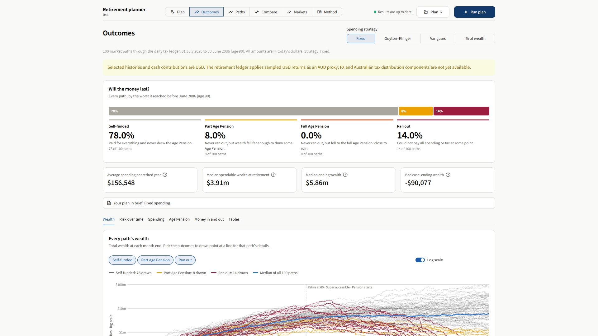
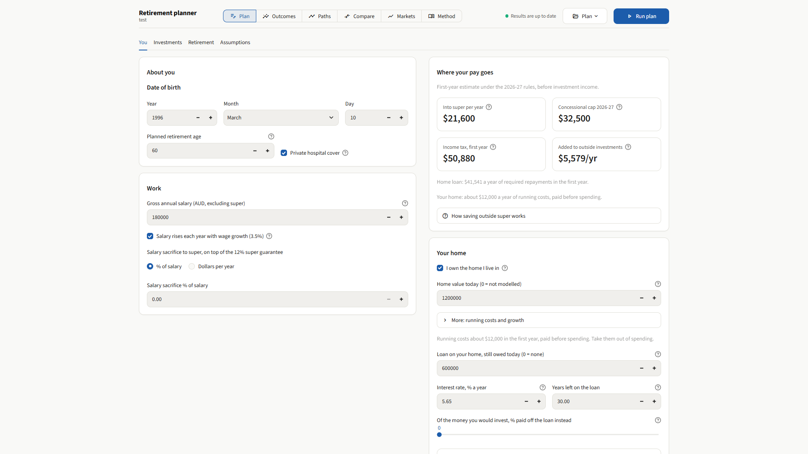
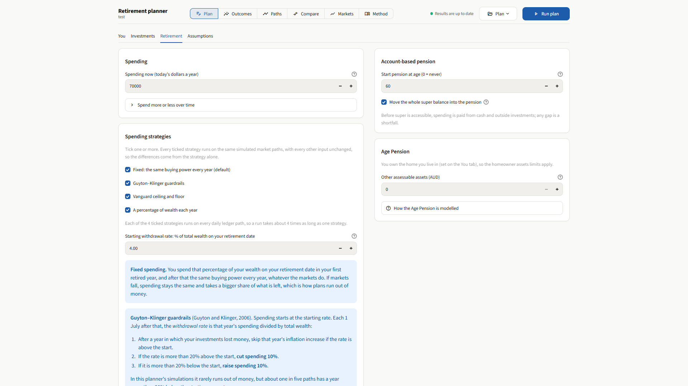
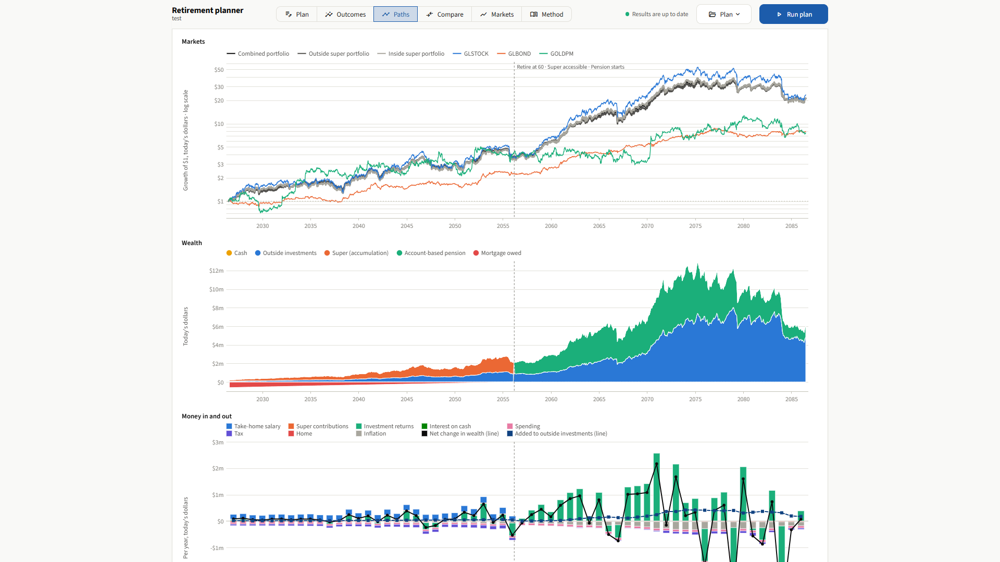
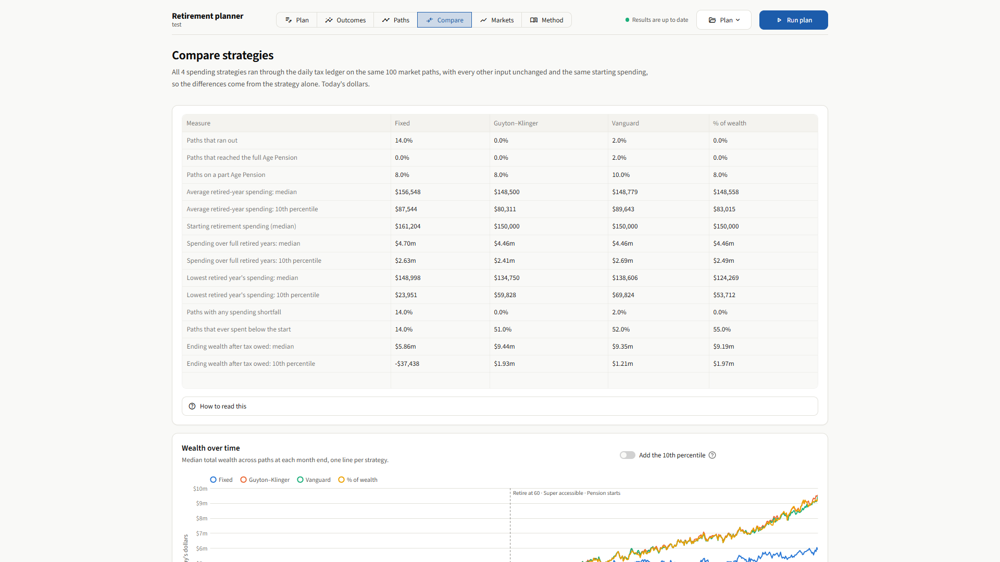
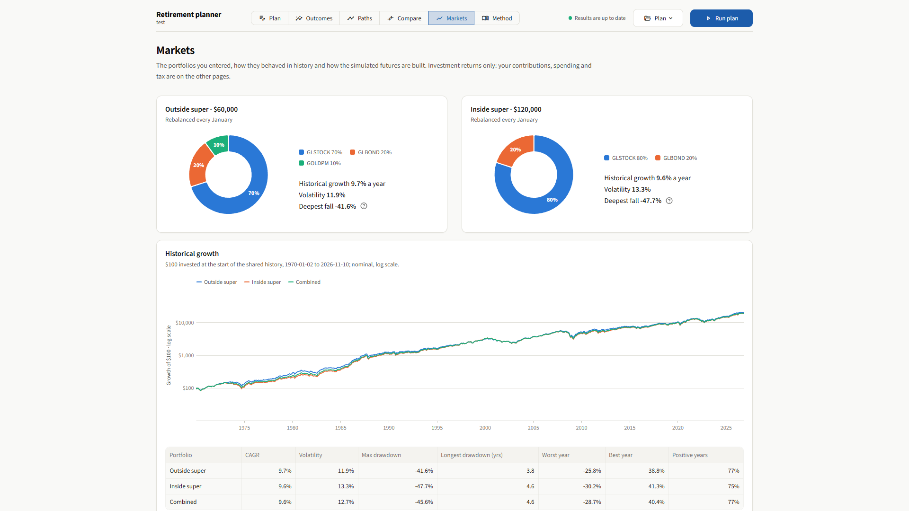
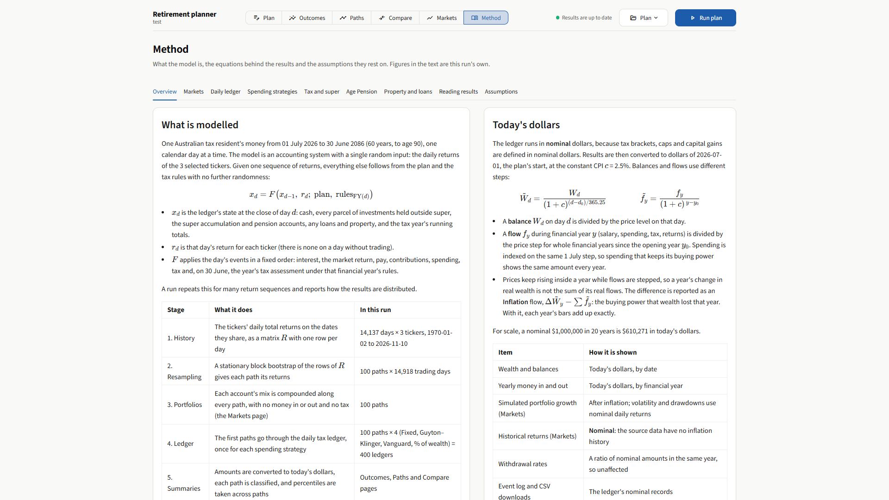
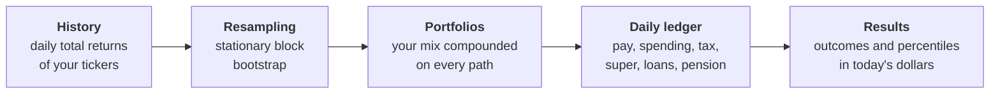

# Financial Simulations

**A retirement planner for Australians that simulates your money one day at a time.**

Enter your pay, spending, investments, super and home. The app generates many possible market futures from
decades of daily returns, runs every one through Australian tax, super and Age Pension rules, and shows how
often the money lasts, how much you could spend and what the bad cases look like.

It runs locally in your browser. Your plan and results never leave your machine.

[](https://github.com/mwilczynska/financial_simulations/actions/workflows/tests.yml)




> [!NOTE]
> This is a research tool, not financial advice. The screenshots use an invented plan: a 30-year-old on
> $180,000 with a $600,000 home loan who retires at 60.

## What it answers

- **Will the money last?** Every simulated future is classed as self-funded, on a part or full Age Pension, or ran out.
- **How much can I spend?** Compare four retirement spending strategies on identical markets.
- **What happens in a bad market?** Open any single path and follow each account, tax bill and transfer.
- **What does my portfolio do?** See its history since 1970 and the range of simulated returns.

## A tour

| | |
| --- | --- |
| [](docs/images/plan.png) | [](docs/images/plan-retirement.png) |
| **Plan.** Your age, salary, home, loan and any investment property, with a first-year estimate of tax and saving. | **Spending strategies.** Tick one or more: fixed, Guyton–Klinger guardrails, Vanguard ceiling and floor, or a percentage of wealth. |
| [](docs/images/paths.png) | [](docs/images/compare.png) |
| **Paths.** One future in full: what markets did, what each account held, and the money in and out each year. | **Compare.** Every ticked strategy on the same market paths, so the differences come from the strategy alone. |
| [](docs/images/markets.png) | [](docs/images/method.png) |
| **Markets.** Each portfolio's mix, historical growth, volatility and drawdowns. | **Method.** The model's equations, rules and assumptions, filled in with the figures of your own run. |

## How it works



The only random input is the sequence of daily market returns. Given one sequence, everything else follows
from your plan and the tax rules.

1. **History.** Daily total returns for the tickers you choose, some reaching back to 1970.
2. **Resampling.** Blocks of consecutive days are drawn jointly across tickers, which keeps the correlations
   between assets and the clustering of volatile periods.
3. **Daily ledger.** Each path steps through every calendar day: interest, market return, pay, contributions,
   spending, tax and, each 30 June, the year's tax assessment.
4. **Results.** Amounts are converted to today's dollars, each path is classified, and percentiles are taken
   across paths.

Returns stay daily throughout. Monthly and annual figures are summaries of daily paths.

## What is modelled

| Area | Included |
| --- | --- |
| **Income tax** | Resident rates and offsets, Medicare levy and surcharge, PAYG withholding, the annual assessment |
| **Super** | Super guarantee, salary sacrifice, contribution caps, fund tax, Division 296, access dates, account-based pensions and minimum drawdowns |
| **Investments outside super** | Individual parcels, capital gains tax, distributions, annual rebalancing, a cash buffer |
| **Age Pension** | Income and assets tests, deeming, Work Bonus, SAPTO |
| **Property** | Your home and its running costs, a home loan with extra repayments, an investment property with rent and its own loan |
| **Spending** | Fixed buying power, Guyton–Klinger guardrails, Vanguard ceiling and floor, percentage of wealth, with an optional minimum and maximum |

Rules are sourced for 2026-27 and [recorded with their references](docs/rules/au-2026-27.md). Later years use
[projected rules](docs/rules/au-projection.md) under the CPI and wage growth you assume, with each parameter
marked as enacted, projected or assumed.

## Limitations

- **One person.** Couples are planned, not built.
- **US-dollar returns stand in for Australian-dollar returns.** Exchange rates and Australian distribution
  components such as franking are not modelled yet.
- **A fixed list of tickers.** They are US-listed funds and custom long histories; ASX funds are not supported.
- **Constant inflation and wage growth**, set by you.
- **The future is drawn from the past.** Resampling cannot produce markets unlike any in the sample.

The [plan and app guide](docs/methodology/plan-and-app.md) covers these in detail.

## Run it

You need Python 3.11 or newer, and a checkout of
[financial_datasets](https://github.com/mwilczynska/financial_datasets) with its processed data, in a folder
beside this one. Set `FINANCIAL_DATASETS_PROCESSED` to use a different location.

```powershell
python -m venv .venv
.\.venv\Scripts\python.exe -m pip install -e '.[ui]'
.\.venv\Scripts\python.exe -m financial_simulations ui
```

The app opens at http://localhost:8501 with an invented example plan. Change the inputs and press **Run plan**.

Plans save as TOML in `plans/`, and the same file runs from the command line:

```powershell
.\.venv\Scripts\python.exe -m financial_simulations plan plans/my-plan.toml
```

Each run writes its charts, tables and a manifest of input hashes to `output/plans/<plan-name>/`. Both folders
are git-ignored.

## Research tools

The planner sits on a portfolio simulation library, which also runs from the command line.

| Command | What it does |
| --- | --- |
| `run` | Replay a portfolio through history with daily accounting, rebalancing and dated cash flows |
| `compare` | Compare return generators: historical replay, bootstraps, correlated lognormal and GARCH filtered historical simulation |
| `paired` | Compare portfolios on shared draws, across observed and reconstructed periods |
| `holdout` | Score each generator against what markets did next |
| `reconcile` | Check the accounting against [portfolio_optimisation](https://github.com/mwilczynska/portfolio_optimisation) |

```powershell
.\.venv\Scripts\python.exe -m financial_simulations run scenarios/examples/baseline.toml --output output/baseline
```

Example configurations such as [baseline.toml](scenarios/examples/baseline.toml) are in `scenarios/examples/`. Each command writes PNG charts, CSV
tables and a manifest.

## Documentation

Every model is written up with its equations, sources, validation and limits.

- [Methodology](docs/methodology/README.md): how each calculation works, starting with the
  [retirement ledger](docs/methodology/retirement-ledger.md) and the [daily engine](docs/methodology/daily-engine.md)
- [Decision records](docs/decisions/README.md): why each material choice was made, and the alternatives
- [Rule register](docs/rules/au-2026-27.md): the Australian tax and super rules, with sources and effective dates
- [Validation](docs/validation/stage-2a.md): the checks that were run, and their results
- [Literature review](docs/literature-review.md) and [project plan](PLAN.md)

## Development

```powershell
.\.venv\Scripts\python.exe -m pip install -e '.[dev,parquet]'
.\.venv\Scripts\python.exe -m pytest
.\.venv\Scripts\python.exe scripts/check_repository.py
```

The tests use small synthetic fixtures and need no market data. `requirements-dev.lock.txt` pins the tested
Windows and Python 3.14 versions.
